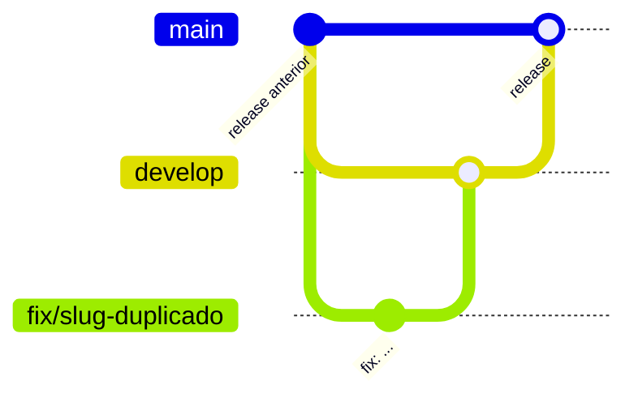

# Contribuição

Para preparar o ambiente, siga o [README](README.md#rodar-localmente). As regras do código estão no [`CLAUDE.md`](CLAUDE.md) e as do visual, no [`DESIGN.md`](DESIGN.md).

O repositório tem dois branches fixos:

- **`main`**: o que está publicado. Só recebe código vindo da `develop`; o CI recusa PR para a `main` de qualquer outro branch.
- **`develop`**: onde o trabalho se junta antes de ir para a `main`.



## Passo a passo

1. **Comece pela `develop` atualizada** e crie um branch com o prefixo do tipo de mudança: `feat/`, `fix/`, `docs/`, `refactor/`, `chore/` ou `ci/` (ex.: `fix/slug-duplicado`).

   ```bash
   git switch develop && git pull
   git switch -c fix/slug-duplicado
   ```

2. **Commits em inglês**, com o mesmo prefixo (`fix: give clashing slugs a numeric suffix`).
3. **Abra o PR para a `develop`** e preencha o template. Se o PR resolve uma issue, escreva `Fecha #123`.
4. **O CI precisa passar:** `tests`, `coverage` (mínimo de 80%), `static` (tipos e lint) e `docker` (build da imagem). Rode antes `pnpm typecheck && pnpm lint && pnpm test`.
5. **Merge na `develop`** do jeito que preferir. O costume tem sido "Squash and merge", para cada PR virar um commit só, mas não é regra. Depois apague o branch.
6. **Release:** quando a `develop` estiver pronta para ir ao ar, abra um PR da `develop` para a `main` listando os PRs que ele leva. Use **"Create a merge commit"**, não squash: com squash, a `main` ganha um commit que a `develop` não tem, e o próximo release mostra mudanças que já foram.

Correção urgente segue o mesmo caminho (branch, PR para a `develop`), com o release aberto logo depois do merge.
